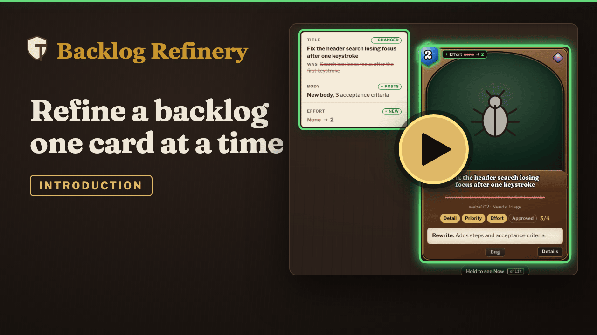

<div align="center">

<h1></h1>

<p><strong>Refine a GitHub Projects board one card at a time, against a Definition of Ready.</strong></p>

<p>
  <a href="LICENSE"></a>
  <a href="#quick-start"></a>
  <a href="docs/how-it-works.md"></a>
  <a href="docs/agent-handoff.md"></a>
</p>

<p>
  <a href="#quick-start">Quick start</a> ·
  <a href="#docs">Docs</a> ·
  <a href="docs/agent-handoff.md">Agent hand-off</a> ·
  <a href="docs/remote-access.md">Remote access</a>
</p>

</div>

<a href="https://youtu.be/JUKkSp4rvpE"></a>

Figure: a 1:52 introduction video, from one card and its four checks through End turn to running the demo

Backlog Refinery shows one card for each backlog item on your GitHub Projects v2 board. Each card answers one question: is it ready? The four checks are Detail (acceptance criteria), Priority, Effort (the board's estimate) and Approved (your click). Under every check that is not met sits a recommended update, ready to edit. You approve or skip, and move on. The checks follow SSW's Definition of Ready.

The app never writes to GitHub. Your decisions are saved to a data folder, and a Claude Code session or a script of your own applies them.

## Highlights

<table>
  <tr>
    <td width="50%" valign="top"><b>One card, four checks</b><br>Detail, Priority, Effort and Approved, with the missing pieces already drafted. <a href="docs/how-it-works.md">How it works</a></td>
    <td width="50%" valign="top"><b>Decisions on disk, never on GitHub</b><br>Accepted cards become <code>plan.json</code> and <code>PLAN.md</code> for an agent to apply. <a href="docs/agent-handoff.md">Agent hand-off</a></td>
  </tr>
  <tr>
    <td width="50%" valign="top"><b>Priority from a score</b><br>A score out of 100 sets the board's Priority, with a script that keeps the two in line. <a href="docs/priority-sync.md">Priority sync</a></td>
    <td width="50%" valign="top"><b>Your board, from config</b><br>Owner, repos, private repos and field ids live in <code>config.json</code>, and <code>npm run init</code> writes it for you. <a href="docs/configuration.md">Configuration</a></td>
  </tr>
  <tr>
    <td width="50%" valign="top"><b>A demo with no board</b><br><code>npm run demo</code> serves ten made-up cards, and changes never leave a temp folder. <a href="#quick-start">Quick start</a></td>
    <td width="50%" valign="top"><b>Stage mode for talks</b><br>Deals only public cards, hides private refs and sets larger type. <a href="docs/how-it-works.md#stage-mode">Stage mode</a></td>
  </tr>
</table>

## Quick start

You need Node 20 or later. There are no dependencies and no build step.

```bash
git clone <this repo> && cd backlog-refinery
npm run demo        # http://localhost:4380 with made-up cards
```

To point it at your own board you also need the [GitHub CLI](https://cli.github.com), signed in with the `project` scope:

```bash
gh auth login
gh auth refresh -s project
npm run init -- <owner> <project-number>     # writes config.json from your board
npm start
```

`npm start` with no `config.json` falls back to the demo and tells you how to run init.

Your board needs:

1. A **Status** single select. The app loads the columns named in `statuses` in `config.json`.
2. An **Estimate** number field.
3. A **Priority** single select with Urgent, High, Medium and Low.
4. Optionally, a **Priority Score** number field for the [score bands](docs/priority-sync.md).

`npm run init` finds the field and option ids with `gh project field-list` and tells you anything it could not match.

`data/` and `config.json` hold your board's issue text and ids. Both are git-ignored. Do not commit them, especially for private repos.

## Docs

| Page | What it covers |
| --- | --- |
| [How it works](docs/how-it-works.md) | The piles, the plan, what each accepted action does, stage mode and testing against a copy of the data |
| [Configuration](docs/configuration.md) | Every `config.json` key and the environment variables |
| [Agent hand-off](docs/agent-handoff.md) | The `plan.json` contract, applying it with `gh` or Claude Code, and marking items applied |
| [Priority sync](docs/priority-sync.md) | The score bands and the script that keeps Priority in line |
| [Remote access](docs/remote-access.md) | A launchd agent and reaching the app from a phone over Tailscale |
| [Agent workflows](examples/agent-workflows/README.md) | The prompts one team uses to draft suggestions, kept as worked examples |

`suggestions.json` holds the agent's recommended update for each card. The app only reads it, so any agent can write it. [CONTRIBUTING.md](CONTRIBUTING.md) covers the ground rules for changes.

## Licence

MIT, see [LICENSE](LICENSE).
